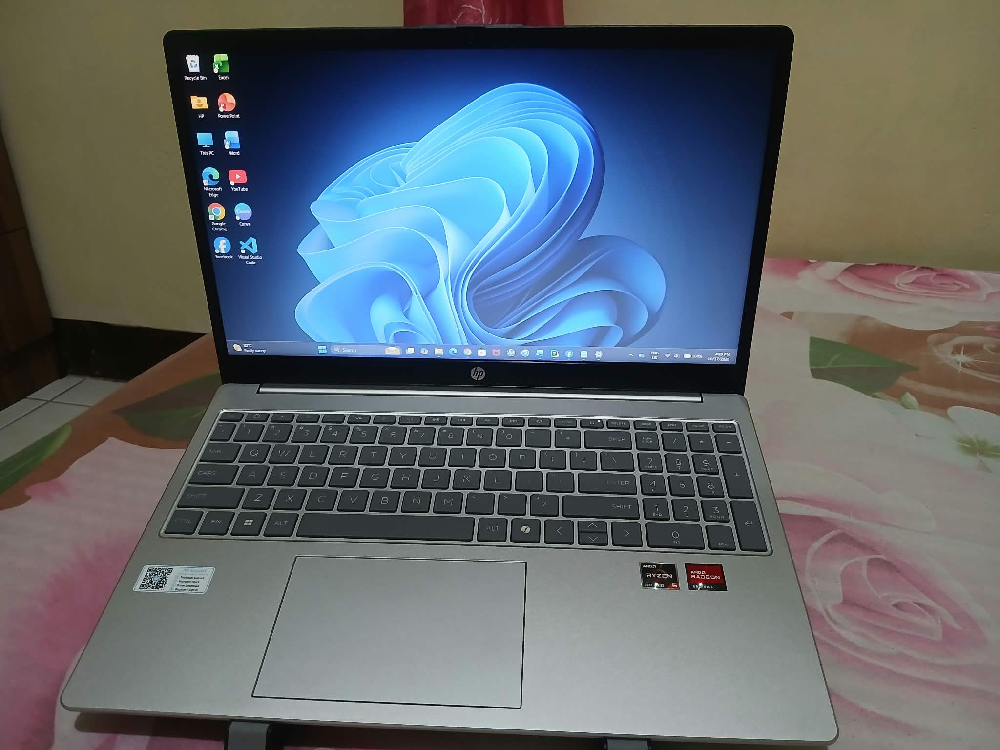

# CC 101 Computing Portfolio
 
This repository contains my laboratory outputs and documentation for *CC 101 Introduction to Computing* at **Sorsogon State University – Bulan Campus**.
 
## About Me
 
- **Name:** Kylie A. Estonanto
- **Program and Section:** BSCS 1-1
- **Interests:** Listening to Music, Playing Guitar, Technology
- **Goal:** To be able to use and create technology to solve real world problems
 
## Course Information
 
| Item | Details |
| --- | --- |
| Course | CC 101 Introduction to Computing |
| Instructor | Prof. John Mark Gabrentina |
| Academic Year | 2026–2027 |
 
## Portfolio Contents
 
1. [Week 7 – Pseudocode and Flowcharts](week07-algorithms/)
2. More activities will be added each week.
 
## Sample Pseudocode: Decimal to Binary
 
```
START
         DISPLAY “Enter a whole decimal number (0 or greater): “
         INPUT n

         IF n < 0 THEN
              DISPLAY “Invalid Input!”
         ELSE 
              SET result = “’
              SET x = n 

              IF x == 0 THEN
                  SET result = “0”
             ELSE
                  WHILE x > 0 DO
                         SET r = x MOD 2
                         SET result = CONCAT(r, result)
                         SET x = x DIV 2
                  ENDWHILE
             ENDIF

             DISPLAY “The binary equivalent is: ”, result
ENDIF
END

```
 
## My Workspace
 

 
---
 
*Last updated: 2026-10-17*
